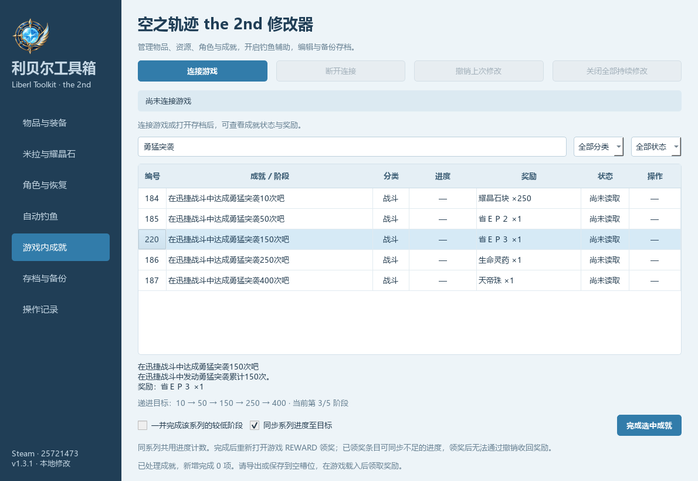

# Liberl Toolkit · 利贝尔工具箱


A Chinese-language Windows trainer and save editor for **Trails in the Sky 2nd Chapter**.

面向《空之轨迹 the 2nd》Steam 版的中文修改器：统一管理物品、资源、角色数值、奖励成就、自动钓鱼和存档。


## 下载与使用

从 [GitHub Releases](https://github.com/wangyendt/liberl-toolkit/releases/latest) 下载 Windows 压缩包，解压后运行 `LiberlToolkit.exe`，无需安装 Python。

1. 启动游戏并读入存档，点击“连接游戏”。
2. 在“物品与装备”搜索名称或编号，选中物品并设置目标数量；书籍也使用这个入口。按 Ctrl 点选多项、Shift 连选，或点击“全选当前结果”，可同时修改多种物品。
3. 实时修改后重新打开游戏菜单查看，并在游戏中另存一个手动存档。

工具自动检测 Steam 和 Steam 库目录。其他安装位置可以指定：

```powershell
.\LiberlToolkit.exe --game-dir "E:\SteamLibrary\steamapps\common\Trails in the Sky 2nd Chapter"
```

也支持通过 `LIBERL_GAME_DIR` 环境变量指定安装目录。目前读取游戏的简体中文物品表，界面为中文。

## 功能

| 页面 | 功能 |
|---|---|
| 物品与装备 | 搜索 1,382 条物品记录，按分类和持有状态筛选，增加物品或设置数量，补满已有消耗品、食材与鱼饵 |
| 米拉与耀晶石 | 分别设置米拉、七属性耀晶石及耀晶石块；实时模式支持锁定 |
| 角色与恢复 | 查看已登记的八名主角，编辑 EXP、当前 HP / EP / CP，一次恢复或持续自动恢复 |
| 自动钓鱼 | 自动提竿、收杆；全自动循环选饵、抛竿、确认奖励并继续下一轮，鱼饵不足时自动切换 |
| 游戏内成就 | 搜索 221 条 REWARD 奖励成就，查看实际进度和领奖状态，逐项完成或同步完成同系列较低阶段 |
| 存档与备份 | 编辑存档副本，导出新文件或写入空的手动槽位，备份全部存档，提取备份 |
| 操作记录 | 修改日志及本次连接的操作撤销 |

物品数量遵守游戏表格上限。U物质、U物质＋和塞姆利亚石支持单项或多选设置，最高 9999。服装和发色也支持单项、多选修改，数量按表中上限限制为 0～1；工具修改拥有记录，穿戴请在游戏中操作，实际穿戴和重启读档效果尚未实测。剧情道具、物品列表中的资源、装饰和导力器机壳只读；“补满已有消耗品 / 食材 / 鱼饵”不自动补满稀有素材或添加服装、发色。

多选后输入统一目标数量，点击“设置选中 N 项”。超出某项上限时按该物品的上限设置，例如目标为 99 时，上限为 1 的书籍设为 1；只读物品自动跳过。全选仅包含当前搜索和筛选结果，界面显示已选、可修改和只读的项数。整批修改共用一次备份和操作记录，点击“撤销上次修改”可一次还原。

自动恢复每 0.2 秒补充到上限，瞬间致死攻击仍可能生效。EXP 的后续等级结算由游戏处理，不直接改等级、技能或剧情队伍。本版不包含一击必杀、伤害倍率、移动倍速或剧情跳转。

## 游戏内成就

此页面处理游戏的 **REWARD 奖励成就**，不调用 Steam 成就接口。条目和奖励名称从用户安装的游戏表读取；没有奖励的隐藏记录不在列表中。

连接游戏或打开存档后，页面显示“未完成 / 可领奖 / 已领奖”、进度、目标和奖励。点击某行的“完成”，或选中后点击“完成选中成就”。默认设置所选条目的完成标记，并勾选“同步系列进度至目标”：计数只提高到当前目标，已有更高数值保留。取消勾选可仅设置完成标记。

勾选“一并完成该系列的较低阶段”，可同时完成该目标之前尚未完成的阶段。比如完成“勇猛突袭150次”时，可连同10次、50次一起完成，250次和400次保持原状态。阶段按目标值排列，正确处理插入在旧编号之间的新阶段。页面显示本次将完成的项数，已完成和已领奖的标记不会重复设置。

同系列共用一个进度计数，提高到较高阶段时，较低阶段的进度也会提高，游戏可能据此自动判定较低阶段完成。工具仅在勾选“一并完成”时直接修改较低阶段的标记。手册、书籍、宝箱和任务记录不会被补满。完成后重新打开游戏的 REWARD 页面，按游戏流程领取奖励；实时修改后在游戏里另存手动存档。存档编辑模式须先导出新文件或保存到空槽位，再回游戏载入并领奖。

已经完成或领奖、但计数还低于目标的条目会显示“同步进度”按钮，可以修正旧版只改标记而留下的 `0/3` 等进度。此操作保留领奖状态，不重复发放奖励。有些计数由游戏根据手册等记录重新计算，后续相关游戏行为可能更新它们；需要时可再次同步。

领奖状态会保留。完成操作后再领奖，工具会拒绝撤销该次操作以覆盖游戏的新状态；单独同步已领奖条目的进度时，可以撤销计数修改，但不会收回奖励。启用本页不会自动完成任何成就。



## 自动钓鱼

实时连接后，在“自动钓鱼”勾选“开启自动钓鱼成功”，选择匹配的鱼竿和鱼饵并抛竿，无需按提竿或收杆键。鱼饵正常消耗，结果页面由玩家确认；鱼饵与钓点不匹配时仍按游戏规则处理。

全自动模式：先在游戏钓鱼点进入鱼竿／鱼饵选择界面，连接工具后点击“开始全自动钓鱼”，再切回游戏。优先使用当前鱼竿与鱼饵；不足时选择其他有库存且适合钓点的鱼饵，必要时从已拥有鱼竿中切换到兼容的鱼竿，自动抛竿、提竿、收线、确认结果并继续下一轮。所有鱼饵按游戏规则消耗，不自动补充库存或添加鱼竿。没有可用的鱼竿／鱼饵组合、离开钓鱼界面、对象改变或长时间无响应时停止。

全自动循环只在游戏为前台窗口时发送短按键，切出游戏暂停，切回后继续。使用游戏当前设置中的键盘确认键（默认 Enter），选饵方向键无响应时尝试 W/S，换竿方向键无响应时尝试 Q/E。按 F8、游戏中按 Esc／右键，或点击“停止循环”可取消；关闭全部持续修改、断开连接和退出工具也会停止循环并释放按键。循环启动时会开启提竿／收线辅助；如果此前未手动开启该辅助，停止循环会一并还原，如果此前已开启则保留原设置。

遇到“似乎没有上钩的迹象”时，全自动模式会确认提示，执行收杆并返回选饵界面，跳过本次没有咬钩的鱼饵，切换其他有库存且适用的组合继续。本次循环所有适用组合均不可用时停止。

取消勾选、关闭全部持续修改、断开连接或正常退出工具都会还原原始判定。提竿／收线辅助只修改运行进程中三个经核对的单字节指令；全自动循环额外修改无咬钩分支的三个返回目标字节，让游戏执行原生收杆并返回选饵，停止循环时还原。菜单仍通过游戏的正常按键操作，不直接写菜单状态或跳过奖励。不修改磁盘游戏 EXE。若强制结束工具，重启游戏可恢复原始判定。存档模式不支持自动钓鱼。

## 存档和备份

在“存档与备份”打开一个存档后，修改先保存在工具内的副本。“保存到空的手动槽位”仅使用尚不存在的 `save000`～`save169`，保留原档及自动、章节和系统存档。回到游戏读取新槽位即可。

工具重新计算 CRC、压缩并校验存档；保留原有 PNG 缩略图和说明文字。说明中的等级等信息在游戏再次保存后更新。

首次写入或启用持续修改前自动备份。旧版工具的本地数据目录继续沿用：

- 备份：`%USERPROFILE%\AppData\Local\Sora2Trainer\backups`
- 操作日志：`%USERPROFILE%\AppData\Local\Sora2Trainer\logs`

撤销会先停止持续修改。若游戏已经改变了刚写入的数值，工具拒绝覆盖后续变化；可以提取备份并另存到空槽位。关闭工具不会自动撤回已经写入的物品和数值。

## 支持版本

目前只验证了 Windows 64 位 Steam 构建 **25721473** 的 `sora_2nd.exe`：

```text
SHA-256: cab62e5872222efb2aaf272be47f14263db4e7132ad7df5255db8efbee9959ea
```

实时连接检查磁盘 EXE 哈希、内存代码和数据结构；版本不匹配时拒绝写入。游戏更新后需要重新适配。

已完成 107 项测试及界面检查，包含物品多选、素材和外观数量修改、批量修改、回滚与撤销，以及钓鱼循环、无咬钩提示确认与换饵、鱼竿兼容、前台检查、按键释放、取消和停止清理。全自动循环在本机实测连续捕获 3 条鱼，自动确认结果并开始后续轮次，蚯蚓从 990 正常消耗到 987；无其他可用组合时停止也已实测。1.5.1 再次实测三轮正常捕获及奖励确认，测试期间未触发无咬钩提示；无咬钩返回和多鱼竿切换路径通过模拟测试，尚待对应实机场景验证。角色自动恢复与资源锁定尚未逐项验证所有战斗场景。

## 开发与构建

使用 Windows 64 位 Python 3.10+；发布包使用 CPython 3.14.0、PySide6 6.12.0、zstandard 0.25.0 和 PyInstaller 6.22.3。

复现发布依赖可安装 `requirements-release.txt`；日常开发可使用 `requirements.txt`。

```powershell
python -m venv .venv
.\.venv\Scripts\python.exe -m pip install -r requirements.txt
.\.venv\Scripts\python.exe app.py
.\.venv\Scripts\python.exe -m unittest discover -s tests -v
.\.venv\Scripts\python.exe -m PyInstaller --noconfirm --clean trainer.spec
```

输出：`dist\LiberlToolkit.exe`。构建 spec 排除环境 PATH 中可能混入的同名 ICU DLL，Qt 使用 Windows 自带 ICU。

便于替换 Qt DLL 的目录式构建：

```powershell
.\.venv\Scripts\python.exe -m PyInstaller --noconfirm --onedir --windowed --name LiberlToolkit --icon assets/liberl-toolkit.ico --add-data "assets/liberl-toolkit.ico;assets" app.py
```

目录式构建应使用干净的 CPython 环境，避免在 PATH 中放入其他程序的 ICU 库。

测试不分发游戏资源或存档。没有本机游戏和测试存档时，存档集成测试会跳过；其余测试使用原创合成表、存档、游戏状态和模拟输入，覆盖物品、成就、钓鱼补丁及循环的行为和停止清理。Qt 界面测试需要安装 PySide6。集成测试默认读取本机 `save065\savedata`，可通过 `LIBERL_TEST_SAVE` 指定一份第二卷尚未拥有的测试存档；不会覆盖原文件。

`--self-check` 做只读启动检查，结果位于 `%USERPROFILE%\AppData\Local\Sora2Trainer\last-self-check.json`。`--achievements` 打开成就页面。`--fishing` 打开钓鱼页面；`--auto-fishing` 在连接成功后开启辅助，默认双击不会自动开启。

## 项目与许可

项目源码使用 [MIT License](LICENSE)。第三方依赖保留其许可证，见 [第三方说明](THIRD_PARTY_NOTICES.md)。项目和发布包不包含游戏 EXE、资产包、提取表格、玩家存档、内存转储、第三方修改器或参考仓库；游戏表格在运行时从玩家自己的安装目录读取。

这是独立的玩家工具，与 Falcom 没有隶属关系。游戏与商标归各自权利人所有。

格式调查参考了 [KuroDLCTools 的 FPAC 说明](https://github.com/falco81/KuroDLCTools/blob/main/pac_wcx_plugin/src/src/paclib.pas) 和 [TrailsintheSky1stChapter 的存档格式调查](https://github.com/turtle-insect/TrailsintheSky1stChapter)，并与本机 the 2nd 数据核对。适配记录见 [存档布局](docs/internals/save-layout.md)、[钓鱼判定](docs/internals/fishing-layout.md) 和 [奖励成就](docs/internals/achievement-layout.md)。
