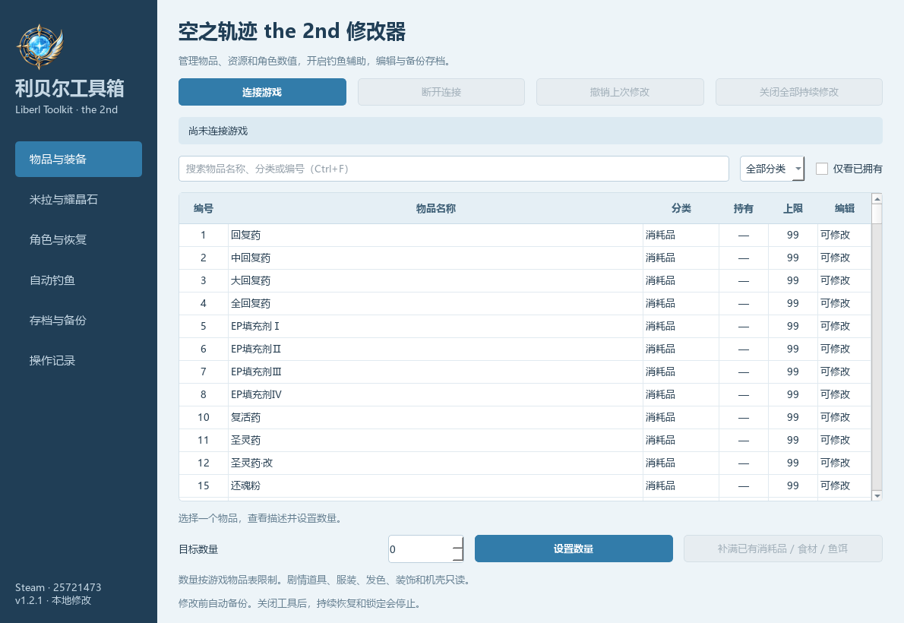

# Liberl Toolkit · 利贝尔工具箱


A Chinese-language Windows trainer and save editor for **Trails in the Sky 2nd Chapter**.

面向《空之轨迹 the 2nd》Steam 版的中文修改器：统一管理物品、资源、角色数值、自动钓鱼和存档。



## 下载与使用

从 [GitHub Releases](https://github.com/wangyendt/liberl-toolkit/releases/latest) 下载 Windows 压缩包，解压后运行 `LiberlToolkit.exe`，无需安装 Python。

1. 启动游戏并读入存档，点击“连接游戏”。
2. 在“物品与装备”搜索名称或编号，选中物品并设置目标数量；书籍也使用这个入口。
3. 实时修改后重新打开游戏菜单查看，并在游戏中另存一个手动存档。

工具自动检测 Steam 和 Steam 库目录。其他安装位置可以指定：

```powershell
.\LiberlToolkit.exe --game-dir "E:\SteamLibrary\steamapps\common\Trails in the Sky 2nd Chapter"
```

也支持通过 `LIBERL_GAME_DIR` 环境变量指定安装目录。目前读取游戏的简体中文物品表，界面为中文。

## 功能

| 页面 | 功能 |
|---|---|
| 物品与装备 | 搜索 1,382 条物品记录，按分类和持有状态筛选，增加物品或设置数量，补满已有消耗品、食材与鱼饵 |
| 米拉与耀晶石 | 分别设置米拉、七属性耀晶石及耀晶石块；实时模式支持锁定 |
| 角色与恢复 | 查看已登记的八名主角，编辑 EXP、当前 HP / EP / CP，一次恢复或持续自动恢复 |
| 自动钓鱼 | 抛竿后自动提竿、完成收杆；鱼种、尺寸和奖励由游戏决定 |
| 存档与备份 | 编辑存档副本，导出新文件或写入空的手动槽位，备份全部存档，提取备份 |
| 操作记录 | 修改日志及本次连接的操作撤销 |

物品数量遵守游戏表格上限。剧情道具、服装、发色、装饰和导力器机壳只读；不批量补满稀有素材。

自动恢复每 0.2 秒补充到上限，瞬间致死攻击仍可能生效。EXP 的后续等级结算由游戏处理，不直接改等级、技能或剧情队伍。本版不包含一击必杀、伤害倍率、移动倍速或剧情跳转。

## 自动钓鱼

实时连接后，在“自动钓鱼”勾选“开启自动钓鱼成功”，选择匹配的鱼竿和鱼饵并抛竿，无需按提竿或收杆键。鱼饵正常消耗，结果页面由玩家确认；鱼饵与钓点不匹配时仍按游戏规则处理。

取消勾选、关闭全部持续修改、断开连接或正常退出工具都会还原原始判定。该功能只修改运行进程中三个经核对的单字节指令，不修改磁盘游戏 EXE。若强制结束工具，重启游戏可恢复原始判定。存档模式不支持自动钓鱼。

## 存档和备份

在“存档与备份”打开一个存档后，修改先保存在工具内的副本。“保存到空的手动槽位”仅使用尚不存在的 `save000`～`save169`，保留原档及自动、章节和系统存档。回到游戏读取新槽位即可。

工具重新计算 CRC、压缩并校验存档；保留原有 PNG 缩略图和说明文字。说明中的等级等信息在游戏再次保存后更新。

首次写入或启用持续修改前自动备份。旧版工具的本地数据目录继续沿用：

- 备份：`%USERPROFILE%\AppData\Local\Sora2Trainer\backups`
- 操作日志：`%USERPROFILE%\AppData\Local\Sora2Trainer\logs`

撤销会先停止持续修改。若游戏已经改变了刚写入的数值，工具拒绝覆盖后续变化；可以提取备份并另存到空槽位。关闭工具不会自动撤回已经写入的物品和数值。

## 支持版本

目前只验证了 Windows 64 位 Steam 构建 **25721473** 的 `sora_2nd.exe`：

```text
SHA-256: cab62e5872222efb2aaf272be47f14263db4e7132ad7df5255db8efbee9959ea
```

实时连接检查磁盘 EXE 哈希、内存代码和数据结构；版本不匹配时拒绝写入。游戏更新后需要重新适配。

已完成 16 项测试及界面检查。实际补物品、自动钓鱼由玩家在游戏中确认；钓鱼监控记录到珍珠草鱼从 0 条增加到 1 条。角色自动恢复与资源锁定尚未逐项验证所有战斗场景。

## 开发与构建

使用 Windows 64 位 Python 3.10+；发布包使用 CPython 3.14.0、PySide6 6.12.0、zstandard 0.25.0 和 PyInstaller 6.22.3。

复现发布依赖可安装 `requirements-release.txt`；日常开发可使用 `requirements.txt`。

```powershell
python -m venv .venv
.\.venv\Scripts\python.exe -m pip install -r requirements.txt
.\.venv\Scripts\python.exe app.py
.\.venv\Scripts\python.exe -m unittest discover -s tests -v
.\.venv\Scripts\python.exe -m PyInstaller --noconfirm --clean trainer.spec
```

输出：`dist\LiberlToolkit.exe`。构建 spec 排除环境 PATH 中可能混入的同名 ICU DLL，Qt 使用 Windows 自带 ICU。

便于替换 Qt DLL 的目录式构建：

```powershell
.\.venv\Scripts\python.exe -m PyInstaller --noconfirm --onedir --windowed --name LiberlToolkit app.py
```

目录式构建应使用干净的 CPython 环境，避免在 PATH 中放入其他程序的 ICU 库。

测试不分发游戏资源或存档。没有本机游戏和测试存档时，11 项存档集成测试会跳过，5 项钓鱼补丁测试仍可运行。集成测试默认读取本机 `save065\savedata`，可通过 `LIBERL_TEST_SAVE` 指定一份第二卷尚未拥有的测试存档；不会覆盖原文件。

`--self-check` 做只读启动检查，结果位于 `%USERPROFILE%\AppData\Local\Sora2Trainer\last-self-check.json`。`--fishing` 打开钓鱼页面；`--auto-fishing` 在连接成功后开启辅助，默认双击不会自动开启。

## 项目与许可

项目源码使用 [MIT License](LICENSE)。第三方依赖保留其许可证，见 [第三方说明](THIRD_PARTY_NOTICES.md)。项目和发布包不包含游戏 EXE、资产包、提取表格、玩家存档、内存转储、第三方修改器或参考仓库；游戏表格在运行时从玩家自己的安装目录读取。

这是独立的玩家工具，与 Falcom 没有隶属关系。游戏与商标归各自权利人所有。

格式调查参考了 [KuroDLCTools 的 FPAC 说明](https://github.com/falco81/KuroDLCTools/blob/main/pac_wcx_plugin/src/src/paclib.pas) 和 [TrailsintheSky1stChapter 的存档格式调查](https://github.com/turtle-insect/TrailsintheSky1stChapter)，并与本机 the 2nd 数据核对。适配记录见 [存档布局](docs/internals/save-layout.md) 和 [钓鱼判定](docs/internals/fishing-layout.md)。
